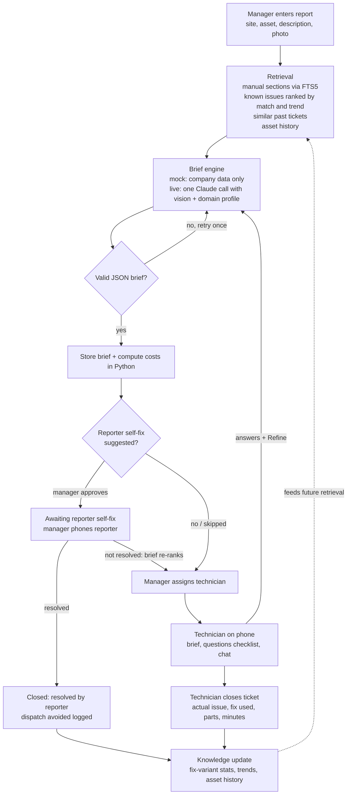

# Architecture

TechMind is a single FastAPI app that renders HTML pages with Jinja2 templates. HTMX adds small interactive bits (chat polling, partial page swaps) without a JavaScript framework. Everything is stored in one SQLite database. Fonts and htmx are bundled in `app/static/`, so nothing loads from a CDN. The only external service is the Claude API, and even that is optional: in `AI_MODE=mock` the brief is built from the company's own data.

## The big idea: no domain knowledge in code

The code only knows generic concepts: **sites**, **assets**, **products** (models), **parts**, **known issues**, **tickets**, and a **reporter** (the person with the broken thing). Everything industry-specific comes from the company's imported data:

- manuals, known issues, parts, and ticket history (CSV + Markdown)
- a **domain profile** (`profile.json`) with the words the UI should use ("store" instead of "site"), what reporters may safely try themselves, what they must never do, and which safety topics matter

The profile is injected into the AI prompt and into every page template. Swapping in a laptop repair shop's data changes the app's vocabulary and advice without touching code.

## Code map

| Path | What it does |
|---|---|
| `app/main.py` | Creates the FastAPI app; on startup creates tables and seeds the demo company |
| `app/config.py` | Reads `.env` (AI mode, database, upload folder, `AS_OF_DATE`) |
| `app/models.py` | All database tables |
| `app/db.py` | Database engine, sessions, FTS5 search tables |
| `app/auth.py` | Password hashing, signed session cookie, `require_login` dependency for pages |
| `app/seed.py` | Loads the demo company and its demo accounts when the database is empty |
| `app/templating.py` | Jinja2 setup; company labels (`L.site`, `L.assets`, …), money and time formatting, ticket status display |
| `app/importer/` | `parse.py` validates import files into a preview; `load.py` writes them; `manuals.py` splits manuals into sections |
| `app/services/retrieval.py` | Gathers what a brief needs: manual sections, known issues ranked by match and trend, similar tickets, the unit's history, parts |
| `app/services/brief.py` | Builds the brief (mock engine from company data, or live via Claude), computes costs, stores versions |
| `app/services/insights.py` | Issue frequency, rising/fading trends, fix-variant success rates and the recommended fix, trips avoided |
| `app/services/tickets.py` | Every ticket change (create, self-fix, assign, answer, close) and the knowledge update on close |
| `app/services/search.py`, `fix_variants.py` | Search-index writes; fix-step normalization |
| `app/ai/` | `schema.py` (the brief's shape, Pydantic), `prompts.py` (the live prompt), `client.py` (Claude calls) |
| `app/routes/` | `public.py` (front page), `login.py`, `tickets.py` (board, intake, ticket actions, close, unit pages), `insights.py` (insights, history, CSV export), `setup.py` (company registration and import, team) |
| `app/templates/` | HTML pages; `partials/` are the pieces HTMX swaps in. Styling is one hand-written stylesheet, `app/static/app.css` |
| `demo_data/` | The fictional demo company, in the import format |
| `scripts/generate_demo_history.py` | Builds and checks `demo_data/assets.csv` and `demo_data/ticket_history.csv` |
| `tests/` | pytest suite |

## Pages and login

- `/` is the login page, which also pitches TechMind in general terms and shows no company's data.
- `/login` checks a username and password against the `users` table. Passwords are stored as salted PBKDF2 hashes.
- A successful login sets a cookie holding the user id plus an HMAC signature made with `SECRET_KEY`. Changing the id in the cookie breaks the signature, so it can't be used to become someone else.
- `/app/...` is the product. Every page there depends on `require_login`, which reads the cookie, loads the user and their company, and redirects to `/login` if anything is missing. All data shown is filtered by that company's id.

## Import: how a company's data gets in

1. **Parse** (`app/importer/parse.py`). Files arrive as name → bytes, so uploads and the demo folder take the same path. Zips are unpacked and `.md` files become manuals. Each CSV is checked for required columns, values are converted (dates, numbers, y/n, `;`-lists, `|`-lists), and every reference is checked (an asset's `model_id` must exist in `products.csv`, and so on). Problems are reported with spreadsheet row numbers. Nothing is written yet.
2. **Load** (`app/importer/load.py`). This creates the company and its default users, then copies every row. Manuals are split at `##`/`###` headings into sections and indexed for search. Each known issue's documented fix becomes its first fix variant. Imported history tickets are grouped by the fix steps they used, so a different fix that technicians have been using becomes its own variant with its own track record.
3. **Register** (`app/routes/setup.py`). A new company's manager fills in the account and uploads files. They're parsed (step 1) and kept in `UPLOAD_DIR/imports/<token>` with the account details (password already hashed) until the review page shows no errors; then they're loaded (step 2), the manager account is created and the manager is logged in.
4. **Seed** (`app/seed.py`). On startup, if there are no companies, the app parses and loads `demo_data/` and creates the demo accounts.

## Ticket flow

Every step writes a row to the append-only `ticket_events` table.

## Data model

Every table has an integer `id` and a `company_id`, so several companies can share one database. Imported records also keep `ref`, the company's own ID (for example `S04`), which is unique per company and is what CSV export writes back out.

| Table | What it holds |
|---|---|
| `companies` | name, domain profile (JSON), labor rate, trip fee, currency |
| `users` | accounts: username (unique across companies), password hash, display name, role `manager` or `technician` |
| `sites` | where assets live (a store, a customer's home) |
| `products` | equipment models: manufacturer, name, category, manual file |
| `assets` | one physical unit: which product, at which site, serial, dates |
| `parts` | price list, which models each part fits, stock |
| `known_issues` | per product: symptoms, root cause, typical minutes, whether the reporter can fix it |
| `fix_variants` | the different ways a known issue has been fixed (steps + where they came from) |
| `manual_chunks` (+ FTS5 index) | manuals split into sections for keyword search |
| `tickets` | the report, status, assignment, reporter answers, and the closing outcome |
| `tickets_fts` | FTS5 index of ticket descriptions, for "similar past tickets" |
| `briefs` | every generated brief version for a ticket, with token usage |
| `ticket_events` | append-only log of everything that happened to a ticket, including chat messages |

Ticket status moves `new → briefed → awaiting_self_fix → assigned → closed` (the self-fix step is optional).

## Adaptability logic

All of this is plain SQL and Python over the tickets table; there is no model training.

- **Fix variants.** Each known issue can have several fixes. Success stats (attempts, successes, average minutes) are computed from the tickets that used each variant. The **recommended fix** is the variant with the best success rate among those with at least 3 attempts; ties go to the faster one, and the company's listed fix keeps the title on an equal rate. When closing, the technician picks the fix they used from a list; if they describe something else, a small Claude Haiku call (or word overlap in mock mode) decides whether it matches an existing variant or is new.
- **Common issues.** Each issue's recent frequency is a recency-weighted count over the last 90 days: a ticket counts `1 - age/90`, so today counts 1, 45 days ago 0.5, and 90 days ago nothing. An issue is **rising** if the last 30 days had more tickets than the 30 before, **fading** if fewer. The busier of the two windows needs at least 2 tickets, so a single ticket (1 vs 0) doesn't count as a trend. Retrieval ranks known issues by this score, so briefs shift as conditions change.
- **Repeat failures.** An asset with 3 or more tickets in 60 days is flagged in the brief and on its page.

## The brief: mock and live

Both engines return the same validated shape (`app/ai/schema.py`):

- **Mock** (`app/services/brief.py`): causes are the known issues whose symptoms share the most words with the report (a small stemmer makes "leaking" match "leak"), boosted by recent frequency and a rising trend. Answers re-rank them: "yes" to a question about a cause raises it, "no" lowers it, and a failed self-fix pushes its targets down. Questions ask about each cause's most distinctive symptom that the report didn't already mention. The self-fix uses only issues the company marked as reporter-fixable. Safety topics are included when the hazard's name matches the likely causes.
- **Live** (`app/ai/`): the same retrieved context, the photo and the domain profile go to `claude-sonnet-5-5` in one call. The reply is validated with Pydantic and retried once if invalid. Any failure falls back to the previous brief or a mock one, with a notice on the page.

In both, costs are computed in Python from the parts list, the labor rate and the trip fee (on-site visits or once a technician is assigned). The AI only picks part ids and minutes.
