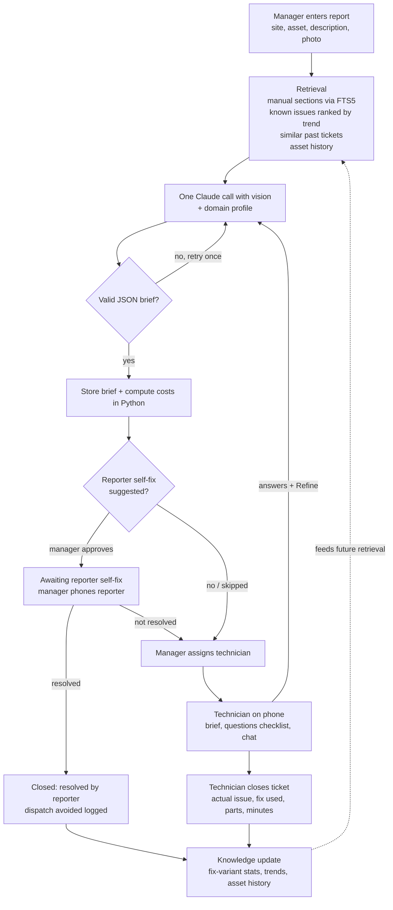

# Architecture

TechMind is a single FastAPI app that renders HTML pages with Jinja2 templates. HTMX adds small interactive bits (chat polling, partial page swaps) without a JavaScript framework. Everything is stored in one SQLite database. The only external service is the Claude API, and even that can be swapped for canned fixtures (`AI_MODE=mock`).

## The big idea: no domain knowledge in code

The code only knows generic concepts: **sites**, **assets**, **products** (models), **parts**, **known issues**, **tickets**, and a **reporter** (the person with the broken thing). Everything industry-specific comes from the company's imported data:

- manuals, known issues, parts, and ticket history (CSV + Markdown)
- a **domain profile** (`profile.json`) with the words the UI should use ("store" instead of "site"), what reporters may safely try themselves, what they must never do, and which safety topics matter

The profile is injected into the AI prompt and into every page template. Swapping in a laptop repair shop's data changes the app's vocabulary and advice without touching code.

## Ticket flow

Every step writes a row to the append-only `ticket_events` table.

## Data model

Every table has an integer `id` and a `company_id`, so several companies can share one database. Imported records also keep `ref`, the company's own ID (for example `S04`), which is unique per company and is what CSV export writes back out.

| Table | What it holds |
|---|---|
| `companies` | name, domain profile (JSON), labor rate, trip fee, currency |
| `users` | people in the "Log in as" picker, with role `manager` or `technician` |
| `sites` | where assets live (a store, a customer's home) |
| `products` | equipment models: manufacturer, name, category, manual file |
| `assets` | one physical unit: which product, at which site, serial, dates |
| `parts` | price list, which models each part fits, stock |
| `known_issues` | per product: symptoms, root cause, typical minutes, whether the reporter can fix it |
| `fix_variants` | the different ways a known issue has been fixed (steps + where they came from) |
| `manual_chunks` (+ FTS5 index) | manuals split into sections for keyword search |
| `tickets` | the report, status, assignment, reporter answers, and the closing outcome |
| `tickets_fts` | FTS5 index of ticket descriptions, for "similar past tickets" |
| `briefs` | every generated brief version for a ticket, with token usage |
| `ticket_events` | append-only log of everything that happened to a ticket, including chat messages |

Ticket status moves `new → briefed → awaiting_self_fix → assigned → closed` (the self-fix step is optional).

## Adaptability logic (planned, Phase 5)

All of this is plain SQL and Python over the tickets table; there is no model training.

- **Fix variants.** Each known issue can have several fixes. Success stats (attempts, successes, average minutes) are computed from the tickets that used each variant. The **recommended fix** is the variant with the best success rate among those with at least 3 attempts; ties go to the faster one. When a technician describes a different fix, a small Claude Haiku call decides whether it matches an existing variant or is new.
- **Common issues.** Each issue's recent frequency is a recency-weighted count over the last 90 days: a ticket from today counts 1, one from 30 days ago counts 0.5, from 60 days ago 0.25. An issue is **rising** if the last 30 days had more tickets than the 30 before, **fading** if fewer. Retrieval ranks known issues by this score, so briefs shift as conditions change.
- **Repeat failures.** An asset with 3 or more tickets in 60 days is flagged in the brief and on its page.
